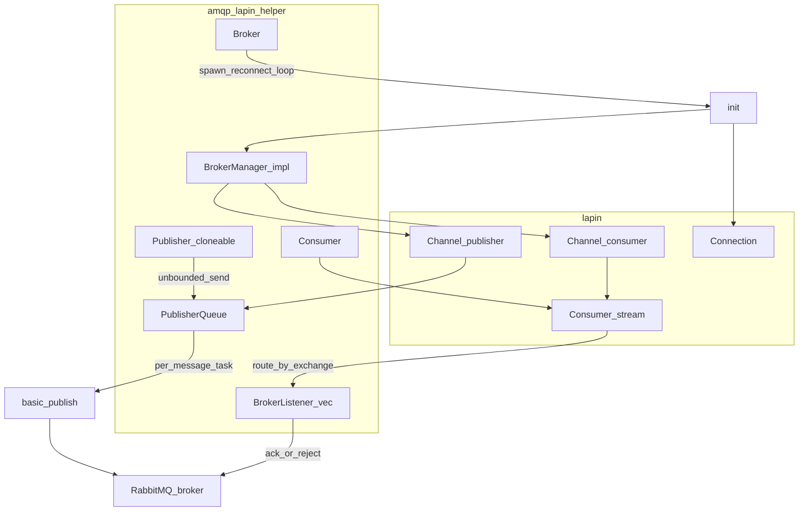

# amqp-lapin-helper

A small Tokio-oriented layer on top of [lapin](https://crates.io/crates/lapin): a reconnecting broker loop, an in-memory publish queue, optional consumers with routing by exchange, and Prometheus metrics.

## Requirements

- **Rust** 1.80 or newer (see `rust-version` in `Cargo.toml`)
- A **Tokio** runtime
- A reachable **AMQP** broker (e.g. RabbitMQ) to run the examples

## Adding the dependency

```toml
amqp-lapin-helper = "0.8"
```

## Core concepts

- **`BrokerManager`** — You implement `declare_publisher` and `declare_consumer` on a lapin `Channel` (exchanges, queues, bindings, `basic_consume`, optional `basic_qos`). Return `Ok(None)` when you only need a publisher or only a consumer; see [`examples/producer.rs`](examples/producer.rs) and [`examples/consumer.rs`](examples/consumer.rs).

- **`BrokerListener`** — Register listeners that each target one logical exchange: `exchange_name()` must match `delivery.exchange` for incoming messages. Defaults: `max_concurrent_tasks` is `1`, `task_rate_limit` is optional (leaky bucket), `task_timeout` is five minutes, `requeue_on_timeout` is `false`. In `consume`, `Ok(())` acknowledges the message; `Err(requeue)` rejects with `requeue` controlling whether the broker should requeue the delivery.

- **`BrokerPublish` and `Serialize`** — `Broker::publish` serializes with **bincode**. Use `publish_raw` when the payload is already encoded.

- **`Broker::spawn`** — Connects in a loop; on failure it waits **1 second** and retries. After a successful connection it runs the consumer loop and the publisher queue until the connection drops, then reconnects.

- **`ready_signal` / `Ready::wait_to_be_ready`** — After the first successful `init`, signals readiness so the rest of the app can start without missing early messages. Waiting times out after **30 seconds** (see `AMQP_READINESS_TIMEOUT` in `src/lib.rs`).

## Architecture

`BrokerManager` runs during `init` on the publisher and consumer channels. Prometheus metrics record durations, queue depth, concurrency, rate limiting, and timed-out tasks on both paths.



## Operational notes

- The publisher uses an **unbounded** in-memory queue. If the broker is unavailable for a long time, memory use can grow; see the `Publisher` documentation in `src/lib.rs`.

- If a delivery’s exchange does not match any registered listener, the broker **nacks** and then **panics**—ensure bindings and `exchange_name()` stay aligned.

## Prometheus metrics

Metrics are registered on the **default** Prometheus registry. Your application must scrape or expose that registry (the examples use `prometheus-hyper`).

| Metric | Kind | Description |
|--------|------|-------------|
| `amqp_consumer_concurrent_tasks` | Int gauge vec | Current vs max concurrent tasks (`exchange_name`, `kind`) |
| `amqp_consumer_rate_limit_tokens` | Int gauge vec | Rate limiter balance vs max (`exchange_name`, `kind`) |
| `amqp_consumer_timed_out_tasks` | Int counter | Tasks that hit the emergency `consume` timeout |
| `amqp_consumer_duration` | Histogram vec | Time spent in `consume` (`exchange_name`) |
| `amqp_publisher_duration` | Histogram vec | Time to publish (`exchange_name`, `routing_key`) |
| `amqp_publisher_msg_queue` | Gauge vec | Pending messages in the publish queue (`exchange_name`, `routing_key`) |

## Examples

Point the CLI at a queue and exchange that exist on your broker (defaults match a simple demo setup). Show options:

```sh
cargo run --example producer -- --help
cargo run --example consumer -- --help
```

By default the examples expose metrics on **127.0.0.1:3765** (producer) and **127.0.0.1:2765** (consumer).

## API documentation

```sh
cargo doc --open
```

## `BrokerListener::exchange_name`

The trait returns `&'static str`. For runtime-defined exchange names you need a stable static string (for example a leaked `String`, as in the consumer example) or a fixed set of constants.

## License

This project is licensed under the MIT License; see [LICENSE](LICENSE).

Repository: [https://github.com/dizda/amqp-lapin-helper](https://github.com/dizda/amqp-lapin-helper)
